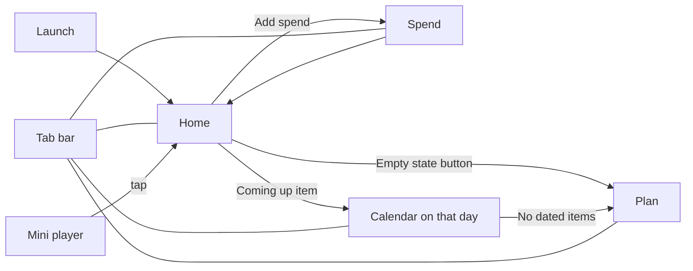

# FLOW.md: how Salary Planner works (v2.1)

How the app moves, what each screen is for, and what happens at every step. Read this before changing navigation, state or calculations. Visual details are in `UI_UX_SPEC.md`; structure is in `ARCHITECTURE.md`.

## 1. Screen map



- Four tabs: Home, Spend, Calendar, Plan. The tab bar is always visible.
- The mini player ("Left to spend" bar) sits above the tab bar on Spend, Calendar and Plan. It is hidden on Home. Tapping it opens Home.
- A settings button (top right) arrives in a later phase.

## 2. Launch

1. App starts and loads saved data from storage (`salary-planner-v1`).
2. Outcomes:
   - **Loaded:** go to Home.
   - **Nothing saved yet:** go to Home in its first-run state (section 4).
   - **Load or migration failed:** show the error screen with "Download raw data". Nothing is shown or saved over the stored data.
3. **Cold launch** (the app was fully closed and reopened): Home plays the launch sequence once.
   1. The greeting shows "Hello, Michael", then swaps once to "Hola, Michael" and stays.
   2. The ring draws and the amount counts up (under 900 ms).
   3. The tab bar and any docked bar slide in.
4. **Warm return** (switching tabs, or the app coming back from the background): no launch sequence, no greeting swap.
5. If a new version is ready, a prompt "A new version is ready" with an Update button appears above the bars. Tapping it reloads into the new version.

## 3. Calculation (never change without asking)

```
income
 - recurring expenses (sum)
 - upcoming one-off costs (sum of all of them, as in v1)
 - debts (sum)
 = after commitments
 - spent this month (daily spending dated in the current month)
 = left to spend
```

- Amounts are KES numbers, rounded to 2 decimals after summing.
- "Today" is the local date as `YYYY-MM-DD`. Week starts on Monday.
- Left to spend is shown on Home (hero) and in the mini player. Both read the same selector.
- State of the number: empty (nothing set up), positive, or negative (shown as over by this month).

## 4. Journeys

### First run
1. Home shows a welcome state: greeting, KSh 0 in a neutral colour, and a card in the style of Calendar's empty state: "Start with your income" and an "Open Plan" button.
2. In Plan the user sets monthly take-home, then adds recurring expenses, upcoming costs and debts.
3. Back on Home the breakdown appears and left to spend is live.

### Log a spend (the most common action, under 10 seconds)
1. From Home tap "Add spend", or open the Spend tab.
2. Type the amount on the keypad. The amount stays visible while typing.
3. Pick a category (the last used one is pre-selected). Date defaults to today. Note is optional.
4. Tap Add (disabled at 0). The entry is saved, the amount resets, a short confirming motion plays, and left to spend ticks down.
5. The entry appears in Recent. Tapping it opens the edit sheet (change or delete).
6. A half-typed amount is kept if the user switches tab and comes back.

### Plan the month
1. Plan tab: Income, Recurring expenses, Upcoming costs, Debts. Each group shows a count and total.
2. Tap a row to edit in a bottom sheet: name, amount, day of month (or date for one-offs), optional end date for debts, note.
3. "Add ..." row at the end of each group opens the same sheet empty.
4. A recurring item or debt with no day shows an "Add day" prompt, because Calendar cannot show it without one.

### See what is due
1. Calendar tab opens on the current week. Selected day heading, then Due and Spent.
2. Every day with something due has a dot, every day with spending has a muted dot, today has a ring, selected day is filled.
3. Month button expands to the month grid. Previous and next move by week (or month in month view).
4. From Home, tapping a Coming up item opens Calendar on that date.
5. If no item has a date, Calendar shows "No dated items yet" with an Open Plan button.

### Mark as paid (pending owner decision, see open question)
1. A due item has a "Mark paid" action.
2. It shows a short confirming motion and a paid state for that date only. It does not change the calculation.

### Backup, restore, clear
1. Plan, Data group: Export backup downloads a JSON file. Import backup reads a file (v1, v2 or v3) and replaces the data after confirmation.
2. Clear all data sits in its own group below. It asks for confirmation ("This cannot be undone. Export a backup first if you may need this data.") and then resets to the empty state.

### Theme (later phase)
1. Settings button, top right, opens a sheet with Appearance: System, Light, Dark.
2. System is the default. Light is Savanna, Dark is Midnight. The choice is saved separately from the app data.

## 5. Data flow

```
user action -> dispatch(action) -> reducer -> new state -> saveState -> localStorage
                                              \-> selectors (summary, due items) -> screens
```

- State lives in one context with a reducer. Screens read it through selectors, never from storage directly.
- Saving happens after every change. If saving fails the user sees a message.
- Loading happens once at start, before any save.

## 6. Edge states

| Situation | What the user sees |
|---|---|
| No income and no items | First-run Home (neutral zero, "Open Plan") |
| Spending exceeds what is left | Hero in the danger colour, caption "Over by this month", ring empty |
| Day with several spends | Day header with the day total, then each entry |
| Day with one spend | One row, no repeated total |
| Recurring item day larger than month length | Shown on the last day of that month |
| Day set to "last" | Shown on the last day of every month |
| Debt past its end date | No longer shown on Calendar |
| Storage full or blocked | Visible message that changes could not be saved |
| Corrupt stored data | Error screen, "Download raw data", stored data untouched |
| Reduced motion on | No animation, same content |

## 7. Open question

Mark as paid needs a small data change (`schemaVersion` 4 with a list of paid occurrences, plus migration and tests). It does not affect the calculation. Confirm with the owner before building (task B6).
